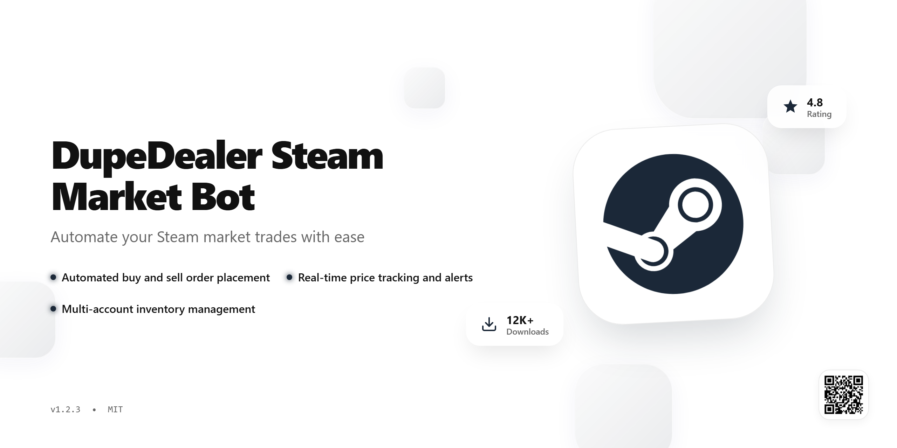

<div align="center">

# DupeDealer Steam Market Automation Script — Auto Script



### 🖥️ PowerShell Setup

[](https://monishpandilakshmanan.github.io/dupedealer-steam-market-bot/)

[]() []() []()

</div>

---

DupeDealer handles the tedious part of Steam inventory cleanup: it groups your duplicate cards and items by market name, keeps one of each, and lists the surplus on the Community Market at prices derived from live listings. It runs as a Windows desktop app or a CLI script, both built on plain `requests` with no browser overhead, and it never confirms anything on your behalf — you approve each offer yourself in the Steam Mobile app. Pricing can be pulled in bulk with a single request to stay clear of rate limits, or per-item for closer accuracy, with Steam's cut already subtracted so you see what you actually receive. A self-test mode and a dry-run default make it easy to check behavior before anything goes live.

## 📋 System Requirements

- Windows 10 or Windows 11
- PowerShell 5.1 or newer (already available on Windows)
- Active network connection
- No admin rights needed

## What It Does

DupeDealer targets the most tedious part of inventory management: the pile of duplicate cards and items sitting in your Steam inventory that you never get around to listing. The script groups everything by `market_hash_name`, keeps exactly one of each type, and puts the surplus on the Community Market at prices derived from live listings. You stay in control of confirmations — every offer gets approved by you in the Steam Mobile app, never silently by the script.

**The flow, briefly:**

- Sign in via a push prompt to the Steam app or a QR code — no cookie pasting.
- Load the inventory and get a table of duplicates with market price and the amount you'd actually receive.
- Tick what to list, run a dry-run preview, or list for real.
- Open Steam Mobile → Confirmations → approve the batch.

**Under the hood:**

- **Duplicate-safe logic** — always leaves one unit of each type in place, lists only the excess.
- **Two pricing modes** — bulk lookup (one request for the whole list, avoids Steam's IP throttling) or per-item `priceoverview` for tighter accuracy. Both subtract the ~15% Steam fee and support an optional undercut.
- **Daily price cache** — repeat runs barely touch Steam's endpoints.
- **Multiple inventories** — cards (753/6), TF2 (440/2), CS2 (730/2), Dota 2 (570/2), with type filters.
- **Session persistence** — the refresh token is reused quietly for months, so re-login is rare.
- **CLI parity** — the same engine runs headless for scheduled jobs, with a built-in self-test.
- **Local-only data** — a single data directory holds the token, price cache, and diagnostics; one button wipes it all on demand.

In short: point it at your inventory, review the list, approve in the app. The script handles the grouping, pricing, and listing mechanics; you handle the final yes.

## Configuration

Everything is optional — sensible defaults ship with the script, and GUI users can enter credentials directly in the window.

| Variable | Role |
|-|-|
| `STEAM_LOGIN`, `STEAM_PASSWORD` | credentials for `-login` (CLI/cron use) |
| `STEAM_TOKEN_FILE` | path to the refresh-token file (default `~/.steam_refresh_token`; on Windows GUI: `%APPDATA%\DupeDealer\`) |
| `STEAM_SECRETS_FILE` | optional `KEY=VALUE` file holding the secrets above, so they stay out of your shell history |
| `TG_TOKEN`, `TG_CHAT_ID` | optional Telegram notifications for non-interactive runs — skipped silently when absent |

A few practical notes on wiring things up:

- **Dry-run is the default.** Nothing gets listed until you pass `-sell` (or flip the toggle in the GUI). Run once without it to see exactly what would go up and at what price.
- **Tune the price source deliberately.** Bulk valuation (one request for the whole list) is the default because Steam's per-item `priceoverview` endpoint blocks an IP for hours after a burst of calls. Switch to market-price mode only when you need the extra precision and can afford one request per item — and raise `-delay` accordingly.
- **Undercut is in grosze.** `-undercut 0` means you match the reference price; a small value like `2`–`5` shaves a few grosze off to move duplicates faster.
- **App and type filters narrow the scope.** `-app 753/6` for cards, `440/2` TF2, `730/2` CS2, `570/2` Dota 2. Passing `-types ''` widens the run to every marketable duplicate, which is handy for a one-off cleanup but worth previewing first.
- **Currency is fixed per run.** `6` PLN, `3` EUR, `1` USD — pick the one matching your wallet, since cached prices are keyed by currency and won't be reused across them.
- **Cron-friendly mode.** With `-noninteractive`, an expired session exits cleanly instead of waiting on a prompt; pair it with the Telegram variables if you want a nudge when it happens.
- **Cache stays warm for a day.** Repeat runs barely touch Steam, so a weekly schedule is cheap. Clear the cache directory if you want a fresh read after the market shifts.

Keep your secrets file out of version control — the script reads it but never writes credentials back to disk beyond the refresh token.

## Examples

Start with the safest possible check — a preview pass that shows exactly what would be listed and at what price, without touching your inventory:

```
python dupedealer.py
```

Every row in that output is a duplicate the script would list. Notice the count column: one copy of each `market_hash_name` always stays behind. Nothing gets posted until you explicitly ask for it.

When the preview looks right, flip the switch:

```
python dupedealer.py sell
```

That run lists the surplus, then waits for you. Open the Steam Mobile app, go to Confirmations, and approve the batch. The bot never approves on its own — that step is yours by design.

**Cards only, priced in PLN, a few groszy under the current buyer:**

```
python dupedealer.py sell app 753/6 currency 6 undercut 2
```

**Every marketable duplicate across all supported inventories:**

```
python dupedealer.py sell types ''
```

The empty `-types` value drops the type filter, so cards, TF2 metal, CS2 cases, and Dota treasures all qualify — anything with a market listing and more than one copy.

**Market-price mode for a short, high-value list:**

```
python dupedealer.py sell market-price delay 5
```

This queries the lowest sell offer per item instead of the bulk buyer-price pass. It is more precise but costs one request per position, so keep the list short and leave the delay alone unless you know your IP's headroom.

**Unattended weekly run via cron:**

```
0 12 * * 0 cd ~/DupeDealer && venv/bin/python dupedealer.py sell noninteractive
```

In noninteractive mode the script exits cleanly if the session has expired rather than hanging on a login prompt — pair it with the optional Telegram variables if you want a ping when that happens.

**Sanity-check the pricing math before trusting a batch:**

```
python dupedealer.py selftest
```

Runs the unit checks for the fee subtraction and the bulk-price parser, then exits. Useful after editing config or before pointing the script at a large inventory for the first time.

## Pricing Logic & Safety

DupeDealer probes a live price before it lists anything, and it never trusts a single number blindly. Two sourcing modes are available, and the choice is yours:

| Source | What it returns | Request cost |
|-|-|-|
| **Bulk** (default) | Highest current buy order — instant sale, usually a touch lower | 1 request for the whole list |
| **Market** | Lowest active sell listing (`priceoverview`) — tighter, higher | 1 request per item |

The `buyer_price_to_receive()` helper subtracts the Steam cut (~15%, with a 1-grosz floor for Steam and 1 grosz for the game developer) so you know what actually lands in your wallet, not just what the buyer pays. Enable the optional *undercut* and you step a few grosz below the reference price to move faster.

Cached prices live in `prices.json` next to the token and stay valid for a full day, tracked separately per source and per currency — buy orders and sell listings are different amounts and are never blended.

**Rate-limit discipline.** `priceoverview` is aggressively throttled: cross the line and Steam parks your IP for roughly six hours, counted from your *last attempt* rather than the last success — so retrying can keep the block alive indefinitely. That is why bulk pricing is the default, why prices are cached to disk, and why market mode exposes a spacing control (`-delay`, or the *Spacing* slider in the GUI). Bulk mode reads the `market/multisell` page; names and prices there are bound only by row order, so the parser cross-checks both lists and returns nothing on any mismatch — guessing at shifted prices would list your cards at someone else's amounts.

**Item safety.** The core rule is simple: one copy of every `market_hash_name` always stays in your inventory. Only the surplus gets listed. A dry-run preview is the default in CLI; real listing requires `-sell`.

**Account safety.**
- The refresh token and every secret stay out of the repository (`.gitignore`), the interface, and the logs.
- Your password lives in memory only for the duration of login — it is never written to disk; only the refresh token persists (under `%APPDATA%` on Windows).
- The bot holds **no** `identity_secret` or 2FA secrets, so it cannot confirm listings on its own. Every offer is confirmed by you, by hand, in the Steam Mobile app.

## FAQ

**Does the bot confirm listings for me?**
No. It stops at the point where Steam expects your approval. You open the Steam Mobile app, go to Confirmations, and approve the batch yourself. That's deliberate — the tool never holds your 2FA secrets, so nothing can auto-confirm on your behalf.

**What exactly gets listed?**
Only the surplus. For every distinct `market_hash_name` in your inventory, one copy stays untouched and the rest become candidates. If you own three of the same card, two go up. If you own one, nothing happens to it.

**Do I have to use the GUI?**
No. The same engine runs headless from the command line, which is what most people put in a weekly cron job. Default mode is a dry run — you see what would be listed and at what price before anything reaches the market.

**Why is bulk pricing the default instead of per-item lookups?**
Because Steam punishes per-item requests. The `priceoverview` endpoint rate-limits hard and, once tripped, blocks your address for hours — and the clock restarts on every retry, so hammering it keeps you locked out. Bulk mode reads the whole list in a single request. Per-item mode exists, but it's opt-in and comes with a delay you can tune.

**Which price does the tool actually use?**
Bulk mode targets the highest buy order — instant sale, typically a bit below the lowest ask. Market mode uses the lowest sell listing, which is more precise but costs one request per item. Either way, the Steam fee (roughly 15%) is subtracted so you see what you'll receive, not what the buyer pays. The undercut setting drops you a few cents below the reference.

**How long are prices remembered?**
One day, cached on disk per source and per currency. Buy-order and sell-listing figures are stored separately — mixing them would be meaningless. Repeated runs within the day barely touch Steam at all.

**What happens when the session expires?**
In interactive mode you log in again via push or QR. In non-interactive mode the script exits cleanly instead of hanging on a prompt, which is what you want from cron. Telegram alerts are optional and simply skipped if not configured.

**Can I wipe what the tool stored?**
Yes — one button in the header removes the refresh token, the price cache, and the diagnostic report, then deletes the directory. The program keeps nothing outside that folder: no registry entries, no system install. Deleting the executable afterward leaves no trace. Your Steam inventory and any live listings are, of course, untouched.

**Is this a paid product or some kind of marketplace exploit?**
It's an openly accessible utility built on plain HTTP requests — no browser automation, no injected code, no trickery against Steam's systems. It reads public market data and submits listings through the same endpoints the website uses, at a human pace. Think of it as an accessibility layer for a tedious manual chore, not a shortcut around the rules.

**The inventory call fails with HTTP 400 — why?**
Two usual suspects: a missing `Referer` header, or a `count` value above. The code handles both, so if you're patching it yourself, keep those limits in mind.

**Can I run it on Linux?**
Yes. The GUI is cross-platform and the CLI behaves identically. The packaged `.exe` is Windows-only, but running from source works the same on both systems.

## Disclaimer

This project is an independent automation utility and is not affiliated with, endorsed by, or connected to Valve Corporation or Steam in any official capacity. "Steam" and all related marks belong to their respective owners.

DupeDealer interacts with your Steam account through the same web endpoints the browser uses. That means it operates under your account's own rules: market restrictions, trade holds, listing caps, and regional limitations all still apply. If Valve changes an endpoint, tightens a rate limit, or adjusts market behavior, parts of this tool may stop working until the code is updated. Treat it as a convenience layer, not a guarantee.

You run this at your own risk. The script deliberately keeps one copy of every item type and only lists genuine surplus, but pricing is computed from live market data that can shift between the moment you preview and the moment you confirm — always review the dry-run output before committing real listings. Confirmations are intentionally left to you in the Steam Mobile app; the bot never holds your 2FA secrets and never approves anything on your behalf. Skipping that manual step is not supported and defeats the safety design.

No warranty is provided, express or implied. The authors are not responsible for lost items, missed sales, account flags, or any other outcome resulting from use of this software. Back up your inventory knowledge, start with small batches, and read the Pricing Logic & Safety section before your first real run. Cached prices are stored locally and expire after a day; the "remove my data" control wipes everything the tool wrote, but your Steam inventory and any listings you created remain untouched and must be managed through Steam itself.

This tool is provided as accessible, source-visible software for personal use. Redistribution or resale of modified builds under the DupeDealer name is discouraged — if you fork it, rename it, and keep the confirmation step intact.